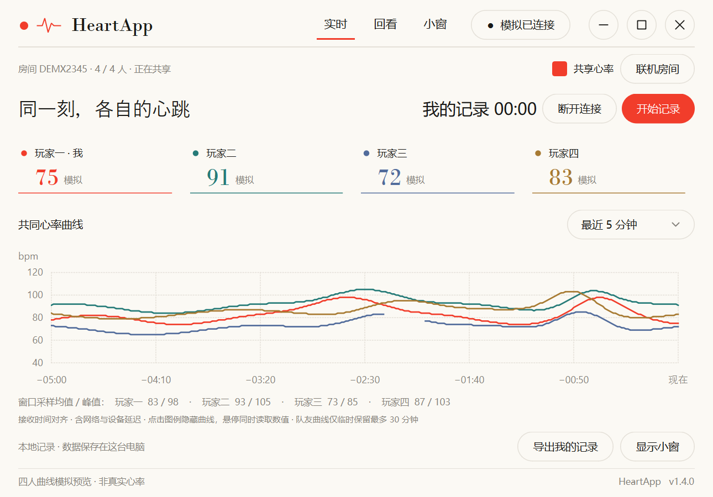
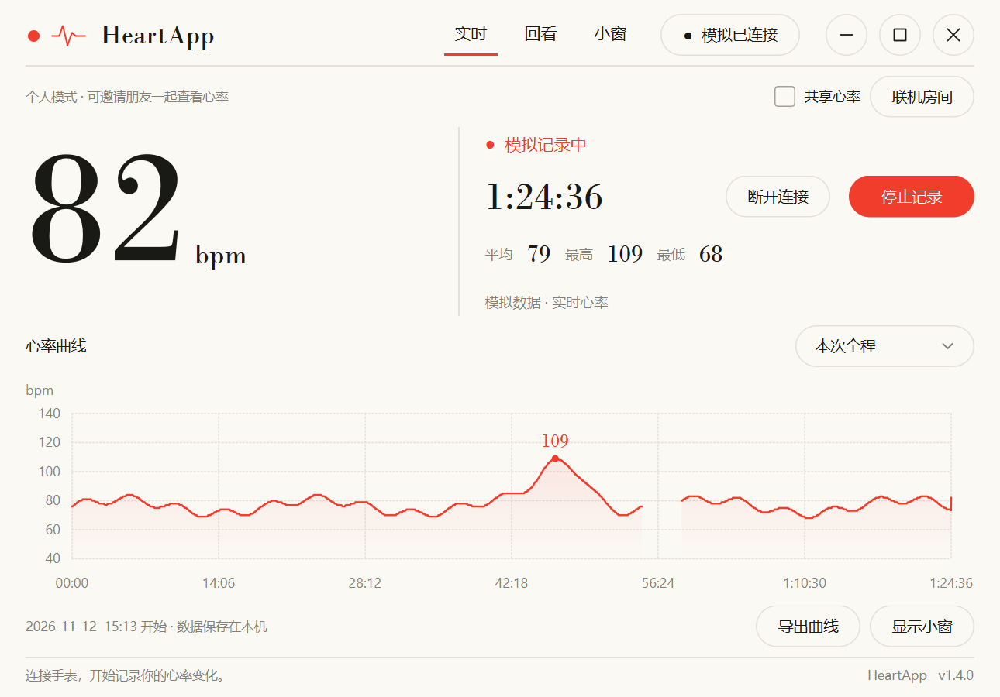
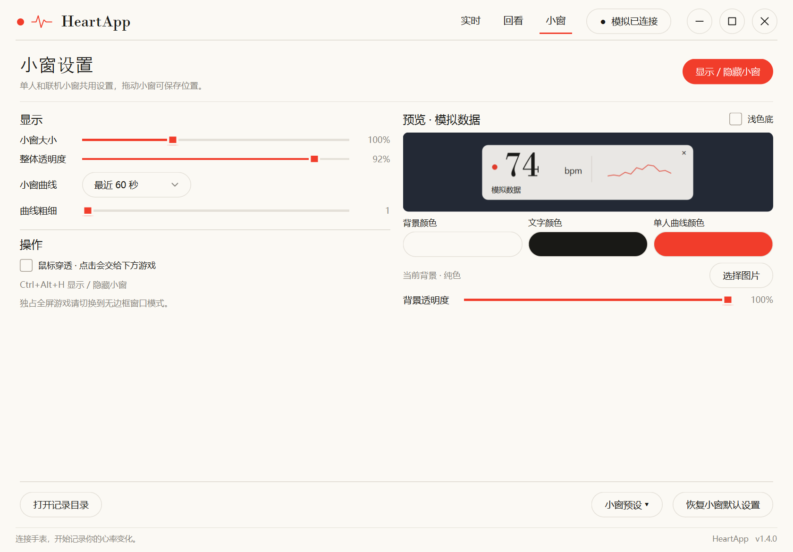
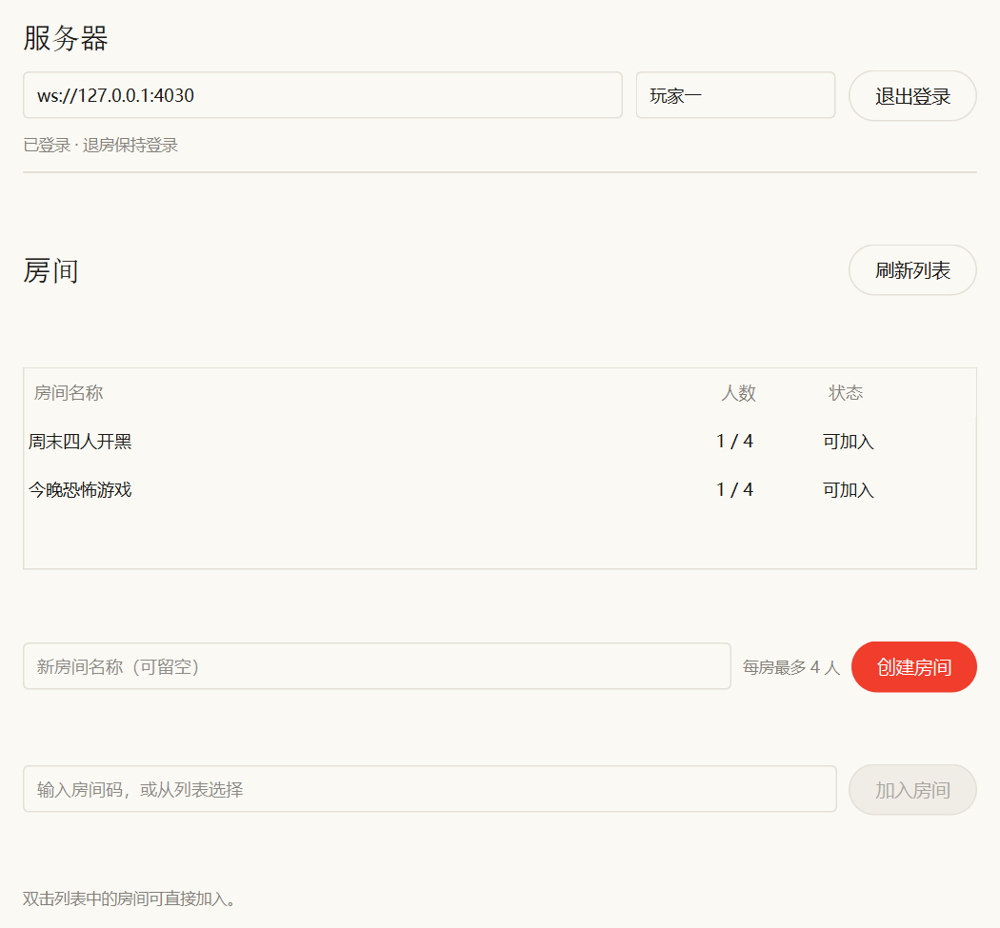
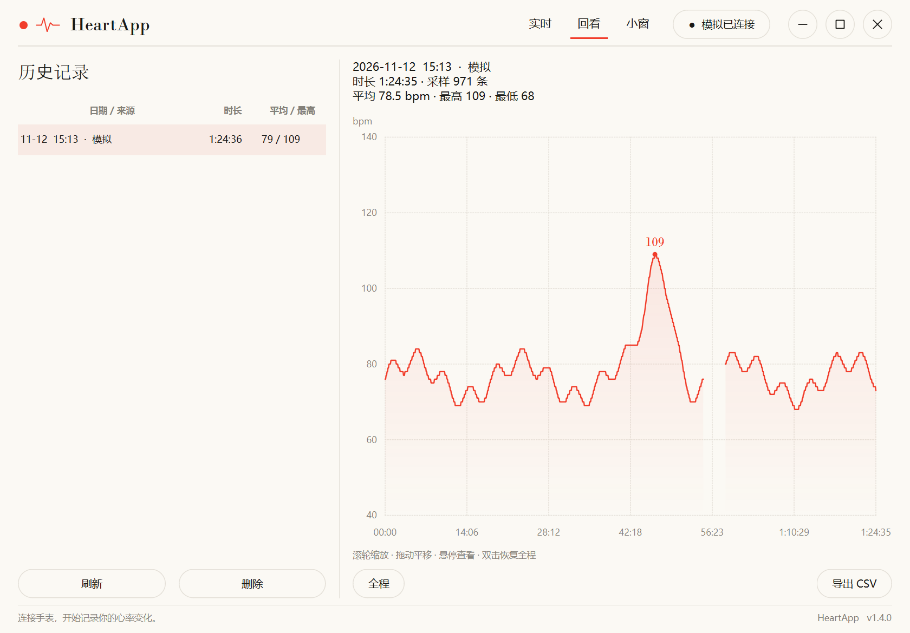

# HeartApp · PC Heart Rate Monitor

[中文](README.md) | **English**

Watch your **real heart rate while gaming or working** on Windows. Reads from any watch
that broadcasts the standard BLE Heart Rate Service, records locally, and can sink data
to a self-hosted server so friends see each other's heart rate on one chart.

[](#)
[](#)
[](https://github.com/soulonlyone/heartapp/releases/latest)
[](LICENSE)
[](https://github.com/soulonlyone/heartapp/actions/workflows/ci.yml)

> **It only reports what it measures.** Heart rate going up is not called "stress" or
> "excitement" — that needs context, and the app does not guess.



<details>
<summary>More screenshots: live / overlay settings / lobby / history</summary>






</details>

## What it is

| Concept | Meaning |
|---|---|
| **Session** | Everything between "Start recording" and "Stop recording", stored locally |
| **Overlay** | Always-on-top window, so you can see your heart rate without alt-tabbing |
| **Review** | Scroll back through the full curve: zoom, pan, hover to read values |
| **Rooms** | Self-hosted server, up to 4 people on one chart (sharing is off by default) |

Recording requires **no interaction** — no manual markers, and the app never interprets
what your heart rate "means".

**What it does not do**: no memory reading, no injection, no input capture; nothing is
uploaded; no scores and no emotion inference.

**Requirements**: the watch must broadcast the standard **Heart Rate Service (`0x180D`)**.
Any brand that follows the spec works — OPPO, Huawei, Xiaomi, Samsung, Garmin, …

## Quick start

**1 · Download** from [Releases](https://github.com/soulonlyone/heartapp/releases/latest):

| File | Notes |
|---|---|
| **`HeartApp-<ver>-win64-portable.zip`** | **Recommended**: unzip and run `图形界面版\心率记录仪.exe` |
| `HeartApp-<ver>-win64.exe` | Single-file build; self-extracts on every start, a bit slower |

> Put it in a **writable folder** (not `C:\Program Files`). On first launch Windows
> SmartScreen may warn — click "More info" → "Run anyway".

**2 · Enable heart-rate broadcasting on the watch** — the only required step, and the
cause of ~90% of failures:

- `Settings → Workout & health → Heart rate broadcast / share`
- On some versions you must **start a workout** first; the toggle lives in the workout UI

If unsure, just click "Scan devices" — once broadcasting is on, the watch appears with a **♥**.
A watch usually allows only one BLE connection, so disconnect it from your phone first.

**3 · Connect and record** — "Connect watch" → pick the device with ♥ → "Start recording".
Click "Show overlay" to keep an eye on it while playing.

## Overlay

| Feature | Notes |
|---|---|
| Always on top | Floats above normal and borderless-windowed games; click-through supported |
| Global hotkey | **Ctrl+Alt+H** |
| Appearance | Size, opacity, image background, color palette, curve length and thickness |
| Presets | Save several presets (including position) and switch anytime |
| Position memory | Restored after restart |

> Exclusive fullscreen covers every overlay — use **borderless windowed** mode for games.

## Rooms

"Live" page → "Room": enter server address and nickname, then create or join a room.
Tick "Share" and everyone sees each other. The main page switches to a shared-axis chart;
the overlay shows one row per player.

**Data boundaries**: sharing is off by default · teammates' curves stay in memory for at
most 30 minutes and are cleared when you leave · the server stores no heart-rate history.

Deploy the server yourself, one line:

```sh
curl -fsSL https://raw.githubusercontent.com/soulonlyone/heartapp/main/server/deploy.sh \
  | sudo bash
```

The installer then asks for a password (**hidden input**), confirms the port and registers a
systemd service. For unattended deployments use `--non-interactive` with the password in
`HEARTAPP_INSTALL_PASSWORD` — passing it on the command line leaves it in shell history.

Windows users can use the server panel (GUI). See [server docs](server/README.md).

## Where the data lives

**`data\heartrate.db` next to the executable** (SQLite) — same for the portable and
single-file builds, and nothing is created in your user profile.
Move the whole folder when you move or update the app; only if the program folder is not
writable does it fall back to `%LOCALAPPDATA%\HeartApp`.

## FAQ

- **Watch not found / no ♥** — broadcast off, still paired to your phone, PC Bluetooth off, or too far
- **Ctrl+Alt+H does nothing** — another app owns the hotkey; use the button in the UI
- **Overlay hidden by the game** — exclusive fullscreen covers it; switch the game to borderless windowed
- **CSV export says "permission denied"** — use "Export CSV → Export to data folder", which skips the system dialog
- **Crashes on startup** — check `启动错误.log` in the program folder; usually antivirus blocking the exe

More in the [user guide](docs/guide.en.md) (English) / [使用指南](docs/使用指南.md) (Chinese).

## Running from source

```powershell
python -m venv .venv
.venv\Scripts\python.exe -m pip install -r requirements.txt
.venv\Scripts\python.exe -m heartapp
```

## Documentation

| Doc | Contents |
|---|---|
| [User guide (EN)](docs/guide.en.md) · [使用指南](docs/使用指南.md) | UI, review, data formats, CLI, FAQ |
| [Development & packaging (EN)](docs/development.en.md) · [开发与打包](docs/开发与打包.md) | Layout, tests, builds, releases |
| [Server docs](server/README.md) | Deployment, access boundaries, troubleshooting |
| [Server panel](server/Windows面板说明.md) | Windows GUI for running the server |
| [Code signing](docs/签名说明.md) | Self-signed certificate |
| [Design notes](docs/pc-monitor-design.md) | Product direction and architecture |
| [AGENTS.md](AGENTS.md) | Conventions for AI collaborators |

## Known limitations

- Broadcast heart rate is **1 sample/second, not beat-to-beat**; HRV is indicative only
- Only the standard BLE Heart Rate Service is supported; vendor protocols won't work
- Exclusive fullscreen hides the overlay; game hotkeys may steal Ctrl+Alt+H
- The self-signed certificate is trusted only on this machine; public WSS / reverse proxy is untested
- No anti-cheat compatibility certification (the app does not inject, read memory, or capture input)

## License

[MIT](LICENSE). Use, modify, sell, and redistribute freely; keep the copyright notice.
