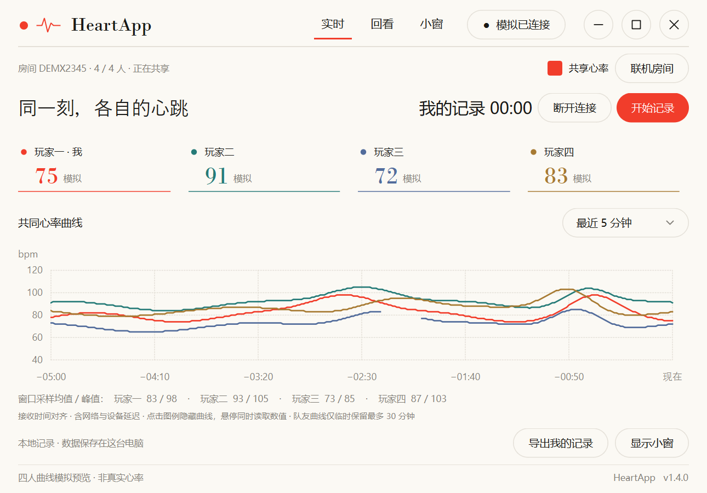
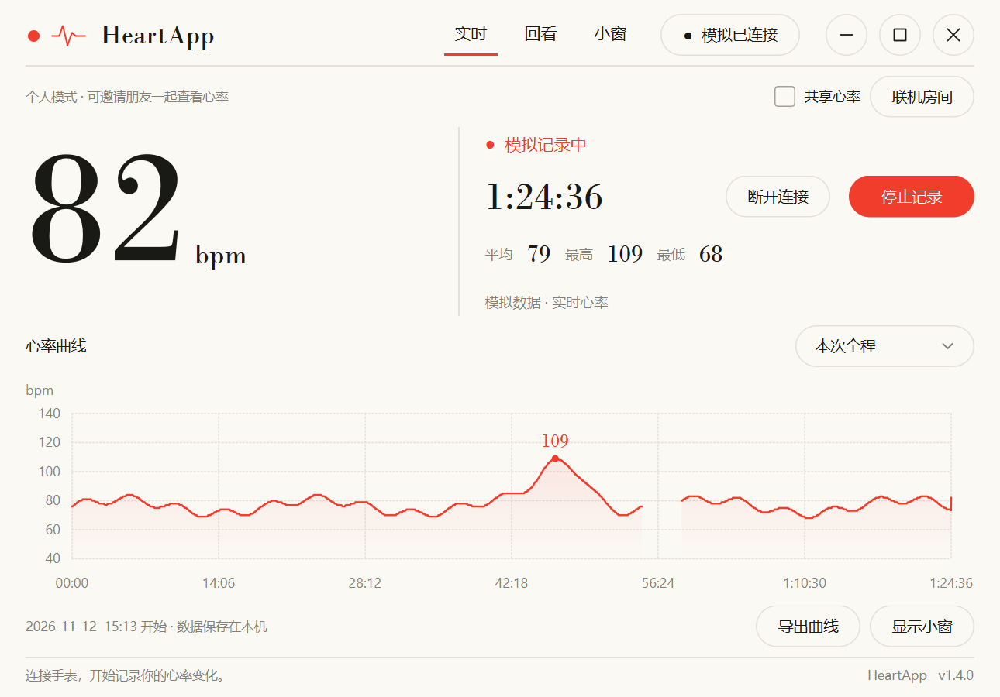
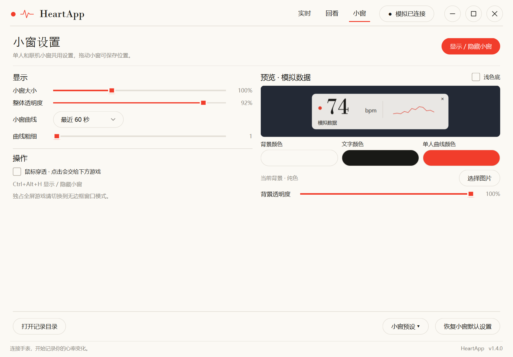
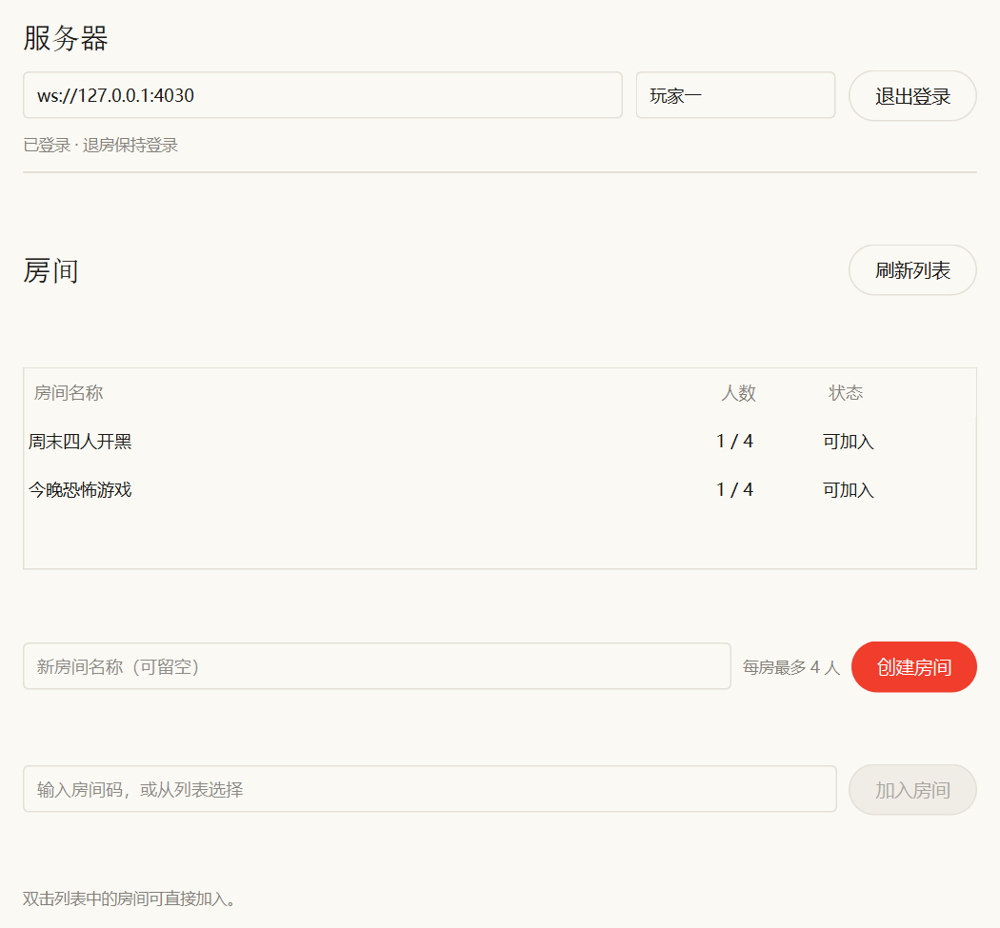
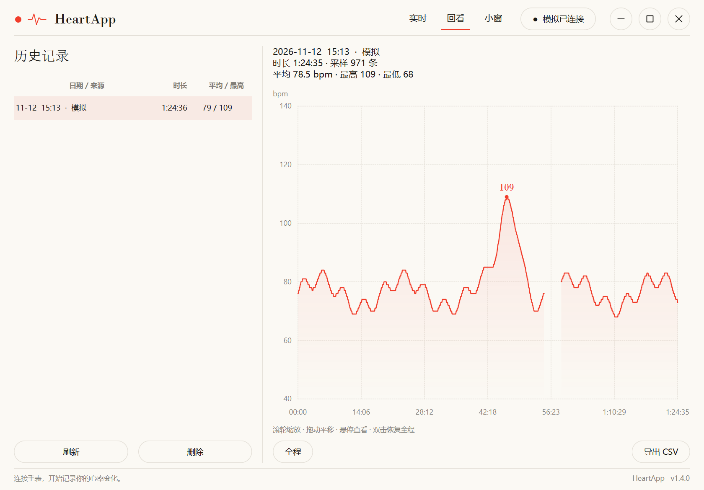

# HeartApp · PC 心率监控

**中文** | [English](README.en.md)

在 Windows 上观察**游戏、工作时的真实心率**。从支持标准 BLE 心率服务的手表读取，
本地记录与回看；也可以自建服务器，和朋友在同一张图上实时对比。

[](#)
[](#)
[](https://github.com/soulonlyone/heartapp/releases/latest)
[](LICENSE)
[](https://github.com/soulonlyone/heartapp/actions/workflows/ci.yml)

> **只描述观察值。** 不把心率升高解释成紧张、压力或兴奋——那需要更多上下文，程序不替你判断。



<details>
<summary>展开看：单机实时 / 小窗设置 / 联机大厅 / 历史回看</summary>






</details>

## 这是什么

| 概念 | 说明 |
|---|---|
| **会话** | 点「开始记录」到「停止记录」之间的一次过程，存进本机数据库 |
| **小窗** | 置顶浮窗，玩游戏时不用切出来就能看心率和短时曲线 |
| **回看** | 事后看整段曲线：缩放、平移、悬停读数 |
| **联机** | 自建服务器，最多 4 人在同一张图上对比（共享默认关闭） |

记录过程**不需要任何操作**：不用手动打点，也不替你解释心率代表什么情绪。

**它不做什么**：不读游戏内存、不注入、不采集输入；不上传你的历史；不评分、不推断情绪。

**设备要求**：支持标准 **Heart Rate Service（`0x180D`）** 并广播心率。
OPPO / 华为 / 小米 / 三星 / Garmin 等符合标准即可，不绑定品牌。

## 快速开始

**1 · 下载** —— 去 [Releases](https://github.com/soulonlyone/heartapp/releases/latest)：

| 文件 | 说明 |
|---|---|
| **`HeartApp-<版本>-win64-portable.zip`** | **推荐**：解压后双击 `图形界面版\心率记录仪.exe` |
| `HeartApp-<版本>-win64.exe` | 单文件版，一个 exe 搞定；每次启动要解压，稍慢 |

> 放在**可写目录**，不要放 `C:\Program Files`。首次运行 SmartScreen 提示点「更多信息」→「仍要运行」。

**2 · 打开手表的心率广播** —— 这是唯一必要的步骤，也是 90% 失败的原因：

- `设置 → 运动与健康 → 心率广播 / 心率分享`
- 部分版本要先**开始一个运动**，运动界面里才有入口

找不到就直接点「扫描设备」——广播一开，列表里会出现带 **♥** 的手表。
手表通常只允许一个蓝牙连接，还连着手机就先断开。

**3 · 连接并记录** —— 点「连接手表」→ 选带 ♥ 的设备 → 点「开始记录」。
想边玩边看就点「显示小窗」。

## 小窗

| 能力 | 说明 |
|---|---|
| 置顶 | 浮在普通窗口 / 无边框窗口化游戏之上，可开鼠标穿透 |
| 全局开关 | **Ctrl+Alt+H** |
| 外观 | 大小、透明度、图片背景、调色盘、曲线时长与粗细 |
| 预设 | 可保存多套（含位置），随时切换 |
| 位置记忆 | 拖动后自动保存 |

> 独占全屏会盖住任何浮窗，建议游戏用**无边框窗口模式**。

## 联机房间

「实时」页 →「联机房间」：填服务器地址和昵称登录，创建或加入房间，勾选「共享」后彼此可见。
主页切换成多人同坐标曲线，小窗每人一行。

**数据边界**：共享默认关闭 · 队友曲线只在内存保留 30 分钟、退出即清空 · 服务端不保存心率历史。

服务器需要自己部署，一行安装：

```sh
u=https://raw.githubusercontent.com/soulonlyone/heartapp/main/server/deploy.sh; s=; for p in '' 'https://ghfast.top/' 'https://gh-proxy.com/' 'https://ghproxy.net/'; do s=$(curl -fsSL --connect-timeout 8 --max-time 25 "${p}${u}" 2>/dev/null) && break; done; [ -n "$s" ] && echo "$s" | sudo bash || echo "所有下载源都失败，可手动下载 deploy.sh 后 sudo bash deploy.sh" >&2
```

直连 GitHub 不通时它会自动换镜像（ghfast.top / gh-proxy.com / ghproxy.net），
不会无限等待；全部失败才提示手动下载。

装的过程中会设置**服务器访问密码**（输入时显示 *，不回显明文；客户端联机时填它，
不是房间密码）、确认端口，然后注册 systemd 服务。
国内直连 GitHub 超时可加镜像：`--version v1.4.0 --mirror https://ghfast.top/`
（详见 [服务端文档](server/README.md)）。
无人值守部署用 `--non-interactive` 并把密码放进环境变量 `HEARTAPP_INSTALL_PASSWORD`
（命令行传密码会留在 shell 历史里）。

Windows 可用服务端面板（可视化开服），详见 [服务端文档](server/README.md)。

## 数据在哪

**程序目录下的 `data\heartrate.db`**（SQLite）——便携版、单文件版都一样，不在用户目录里建文件。
移动或更新程序时把整个文件夹带走；只有程序目录不可写时才退回 `%LOCALAPPDATA%\HeartApp`。

## 常见问题

- **扫描不到手表 / 没有 ♥** —— 广播没开、被手机占用、电脑蓝牙没开、距离太远
- **Ctrl+Alt+H 没反应** —— 被别的软件占用了，用界面按钮代替
- **小窗被游戏挡住** —— 独占全屏会盖住，改成无边框窗口模式
- **导出 CSV 没权限** —— 用「导出 CSV → 导出到数据目录」，不走系统对话框
- **启动就闪退** —— 看程序目录的 `启动错误.log`，通常是杀软拦截

更多见 [使用指南](docs/使用指南.md)。

## 从源码运行

```powershell
python -m venv .venv
.venv\Scripts\python.exe -m pip install -r requirements.txt
.venv\Scripts\python.exe -m heartapp
```

## 文档

| 文档 | 内容 |
|---|---|
| [使用指南](docs/使用指南.md) · [EN](docs/guide.en.md) | 界面、回看、数据格式、命令行、FAQ |
| [开发与打包](docs/开发与打包.md) · [EN](docs/development.en.md) | 项目结构、测试、打包、发布 |
| [服务端文档](server/README.md) | 部署方式、访问边界、排障 |
| [服务端面板](server/Windows面板说明.md) | Windows 可视化开服 |
| [签名说明](docs/签名说明.md) | 自签名证书 |
| [设计说明](docs/pc-monitor-design.md) | 产品方向与架构决策 |
| [AGENTS.md](AGENTS.md) | 给 AI 协作者的开发约定 |

## 已知限制

- 广播心率**每秒 1 次，不是逐拍**；HRV 只能当参考
- 只支持标准 BLE 心率服务，厂商私有协议读不到
- 独占全屏会遮挡小窗，快捷键可能被游戏占用
- 自签名证书只在本机有效；公网 WSS / 反向代理尚未验证
- 未做各游戏的反作弊兼容认证（软件不注入、不读内存、不采集输入）

## 许可

[MIT](LICENSE)。自用、修改、商用、分发都可以，保留版权声明即可。
