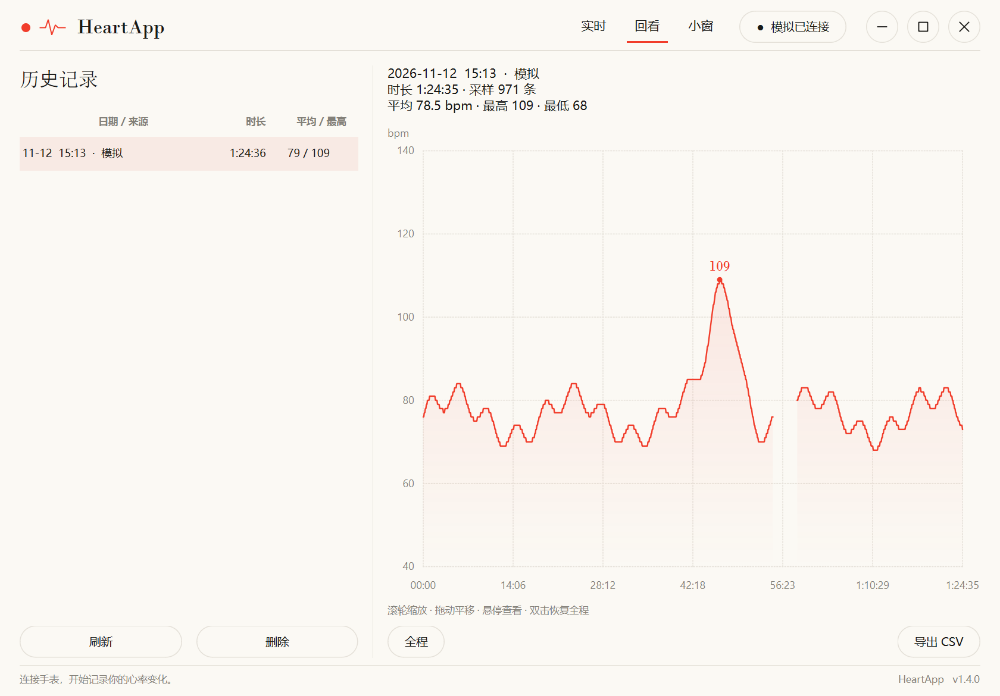

# User Guide

[中文](使用指南.md) | **English**

Read this after you have the app running; the README covers installation only.

## Interface

Three tabs on top: **Live / Review / Overlay**. The main window has no system frame —
drag the title area to move, double-click to maximize, resize from any edge.

| Area | Contents |
|---|---|
| Current heart rate | Large numerals; shows `--` after 5 seconds without data |
| Recording status | Duration + average / max / min |
| Chart | Whole session by default; time range switch at top right |
| Status bar | Database path + "Open data folder" |

> **You cannot switch data source mid-session** — this prevents simulated and real data
> from mixing in one record.

## Review

- **Wheel to zoom**, **drag to pan**, **hover to read**, **double-click to reset**
- Range switch: last 5 minutes / 30 minutes / whole session
- Gaps break the curve — long records are never drawn as fake straight lines
- Hovering shows the real sample timestamp



## Storage & saving

Records live in **`data\heartrate.db` next to the executable** (SQLite); the status bar
shows the actual path.

| Mechanism | Behaviour |
|---|---|
| Timed flush | Commits the buffer every 5–6 s, **independent of new samples**; keeps working if the watch stops streaming |
| Normal exit | Remaining data is saved before quitting |
| Save failure | **Cancels the exit**, keeps the engine and in-memory buffer, then shows an error |
| Crash recovery | WAL + FULL sync; committed data survives, the last few seconds may not |
| Stale sessions | Closed automatically on start, end time = last sample |
| Process lock | Only one recording instance per database; released on exit or crash |

No history is created unless you press "Start recording".

## Database schema

| Table | Contents |
|---|---|
| `sessions` | Start/end, device name, BLE address, source (`ble`/`sim`), note, sample count |
| `samples` | Timestamp, relative seconds, bpm, contact flag, RR intervals |
| `pc_sessions` | PC session metadata (title, activity; FK cascade delete) |
| `session_events` | Legacy event markers (kept for old data) |
| `meta` | Settings |

Ad-hoc analysis: `pd.read_sql("select * from samples", "sqlite:///data/heartrate.db")`

## CSV

UTF-8 with BOM, so Excel opens it without mojibake:

| # | Time | Relative s | bpm | Contact | RR ms |
|---|---|---|---|---|---|
| 1 | 2026-10-30T21:03:12.155 | 0.955 | 122 | yes | 487.6 |

Text starting with `= + - @` is prefixed with `'` to avoid being treated as a formula.

## Command line

```bat
心率记录仪-命令行.exe list                              :: scan nearby devices
心率记录仪-命令行.exe probe "device name"                :: check heart-rate service
心率记录仪-命令行.exe record --device "name" --duration 300 --csv
心率记录仪-命令行.exe record --simulate --duration 60 --csv
心率记录仪-命令行.exe sessions                          :: list sessions
心率记录仪-命令行.exe export 3 --out mine.csv            :: export session 3
```

From source, replace the exe with `python -m heartapp`; `--db <path>` picks a database.

## FAQ

**Watch not found** — broadcast off / paired to phone / PC Bluetooth off / out of range.

**"Device has no heart rate measurement characteristic (0x2A37)"** — connected but not
broadcasting; same causes as above. `probe` shows which services the device offers.

**Ctrl+Alt+H does nothing** — another app owns the hotkey; use the button in the UI.

**Overlay hidden by the game** — exclusive fullscreen covers it; use borderless windowed.

**Heart rate shows `--`** — no valid sample for over 5 seconds; check the watch is awake and in range.

**Export permission denied** — use "Export CSV → Export to data folder". To fix "Save as",
allow the app under `Windows Security → Virus & threat protection → Ransomware protection →
Controlled folder access`.

**Double-click does nothing** — read `启动错误.log` in the program folder; usually antivirus.
Try the portable build.

**Session still shows "recording"** — stale sessions are closed automatically on start.

**Room connection fails** — is the server running (`curl http://127.0.0.1:8765/healthz`),
is the address right, does it need a password, are both sides on protocol v2?

## Room data boundaries

| Item | Behaviour |
|---|---|
| Sharing | Off by default; simulated readings are labelled |
| Teammates' curves | Memory only, at most 30 minutes, cleared on leave, **never written to the database** |
| Server | Stores **no heart-rate history**; rooms/sessions/tokens are in memory |
| Password | Never written to disk; you log in again after restart |
| Disconnects | Stale readings are cleared and reconnected; a 30 s reconnect slot is kept |
| Server outage | Local recording and saving are unaffected |
