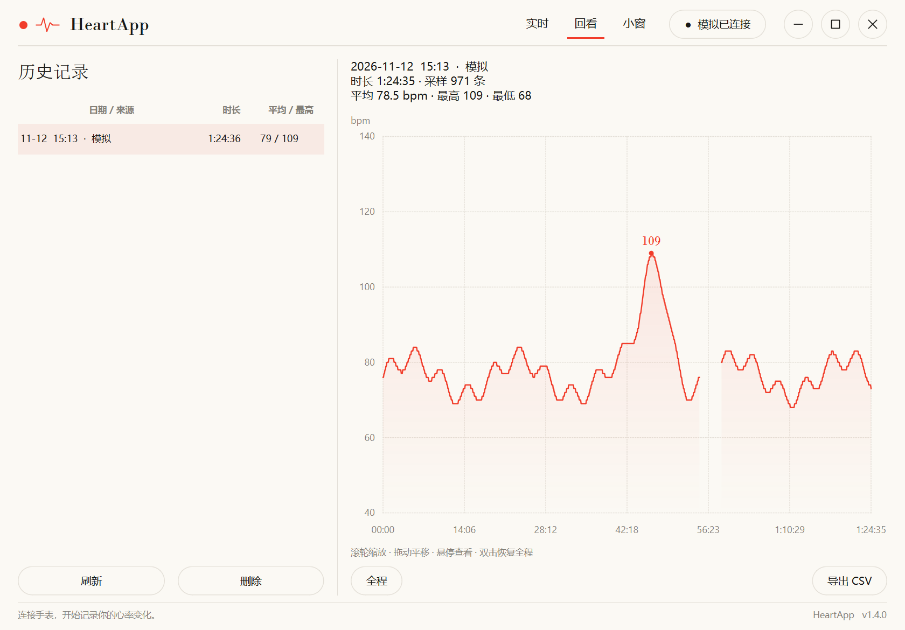

# 使用指南

README 只讲怎么跑起来，这份文档讲细节。装好之后再看。

---

## 界面说明

顶部导航分三页：**实时 / 回看 / 小窗**。

| 区域 | 内容 |
|---|---|
| 当前心率 | 大号衬线数字。超过 5 秒没更新或数据源断开时显示 `--` |
| 记录状态 | 时长 + 平均 / 最高 / 最低 |
| 心率曲线 | 默认本次全程，右上角可切换时间范围 |
| 右上角状态点 | 显示连接情况（灰=未连接、琥珀=连接中、绿=已连接、玫红=记录中） |
| 底栏 | 数据库路径；点击可打开记录目录 |

窗口默认 1120×780，跟随系统缩放。主窗口无系统边框，拖动顶部可移动，
双击标题区域最大化，四边可缩放。

> **会话期间不能更换数据源。** 要换设备请先结束会话，
> 避免把模拟数据和真实数据混进同一次记录。

## 回看曲线

停止记录后，在「回看」页选一条记录：

- **滚轮缩放**、**拖动平移**、**悬停看采样日期、时间与心率**、**双击恢复全程**
- 曲线可切换 **最近五分钟 / 三十分钟 / 本次全程**
- 峰值会标出具体读数
- **缺失数据处曲线断开**，并在原始采样上识别缺口——长记录压缩后也不会被画成假断线



## 数据是怎么保存的

点「开始记录」后，心率持续写入本机数据库，**不需要导出才有记录**。

| 机制 | 说明 |
|---|---|
| 独立定时保存 | 约每 5–6 秒提交一次缓存，**不依赖新样本到达**；手表暂时断流也会保存已有读数 |
| 正常退出 | 先保存剩余数据再退出 |
| 保存失败 | **取消退出**，保留采集引擎和内存缓存，提示排查后重试（不会关了库再试图补写） |
| 崩溃恢复 | 提交使用 WAL + FULL 同步；强制结束进程后，**已提交的数据仍可恢复**，尚未提交的最后几秒无法保证 |
| 残留会话 | 启动时自动收尾，结束时间取**最后一条样本的时间**，不会出现"一次记录持续两天" |

只查看实时心率、没点「开始记录」时，不会创建历史记录。

## 数据库结构

普通单文件版使用 `%LOCALAPPDATA%\HeartApp\heartrate.db`，便携版使用 EXE 旁的 `data\heartrate.db`。

| 表 | 内容 |
|---|---|
| `sessions` | 每次会话一条：起止时间、设备名、蓝牙地址、来源（`ble`/`sim`）、备注、样本数 |
| `samples` | 每个采样点：时间戳、相对秒、心率 bpm、贴合状态、RR 间期 |
| `pc_sessions` | PC 会话元数据：标题、活动类型（外键关联 `sessions`，级联删除） |
| `session_events` | 历史事件标记（旧版本数据保留，当前界面不再产生新事件） |
| `meta` | 设置项（年龄、最大心率） |

底栏的「打开记录目录」可以定位当前数据库。

## CSV 格式

**心率 CSV**（带 UTF-8 BOM，Excel 双击不乱码）：

| 序号 | 时间 | 相对秒 | 心率bpm | 贴合 | RR间期ms |
|---|---|---|---|---|---|
| 1 | 2026-10-30T21:03:12.155 | 0.955 | 122 | 是 | 487.6 |

旧版本记录还可以导出**事件 CSV**（`相对秒, 事件`），和心率 CSV 共用同一条时间轴。
事件名以 `= + - @` 开头时会自动加 `'` 前缀，避免被 Excel 当成公式。

## 命令行用法

```bat
:: 扫描附近设备，标出哪些广播心率
心率记录仪-命令行.exe list

:: 检查设备有没有标准心率服务（排查专用）
心率记录仪-命令行.exe probe "OPPO Watch X2"

:: 记录 5 分钟并导出 CSV
心率记录仪-命令行.exe record --device "OPPO Watch X2" --duration 300 --csv

:: 用模拟数据（不需要手表）
心率记录仪-命令行.exe record --simulate --profile gaming --duration 60 --csv

:: 查看历史列表 / 导出第 3 次记录
心率记录仪-命令行.exe sessions
心率记录仪-命令行.exe export 3 --out 我的心率.csv
```

源码运行时把 `心率记录仪-命令行.exe` 换成 `python -m heartapp`。
`--db <路径>` 可指定数据库文件。

## 常见问题

### 扫描不到手表 / 列表里没有 ♥

1. 心率广播没开（最常见）
2. 手表还连着手机，被占用了 → 手机上关蓝牙再试
3. 电脑蓝牙没打开 → `设置 → 蓝牙和其他设备`
4. 距离太远 → 凑到 1 米内

### 提示「该设备没有心率测量特征（0x2A37）」

连上了但对面没在广播心率，基本等同于上一条。
用 `心率记录仪-命令行.exe probe "设备名"` 能看到它到底提供了哪些服务。

### Ctrl+Alt+H 没反应

可能被别的软件占用了（全局热键是独占的）。界面会提示「全局快捷键不可用」，
此时用主界面上的「显示小窗 / 隐藏小窗」按钮即可。

### 小窗被游戏挡住了

独占全屏会盖住所有浮窗。把游戏改成**无边框窗口模式**，小窗就能浮在最上层。
另外小窗需要开启「置顶」才会压住其他普通窗口。

### 心率数字变成 `--`

超过 5 秒没收到有效读数，或数据源断开。检查手表是否休眠、是否走出蓝牙范围。

### 导出 CSV 提示「没有权限」

不是程序的问题，是**你选的那个文件夹被系统拒绝了**。

最快：点「导出 CSV」旁的小箭头 →「**导出到数据目录**」（不走系统对话框）。

想修好「另存为」到任意位置，常见原因：

1. **Windows「受控文件夹访问」拦截未签名程序**
   `Windows 安全中心 → 病毒和威胁防护 → 勒索软件防护 → 受控文件夹访问`
   → 「允许应用通过受控文件夹访问」→ 添加 `心率记录仪.exe`
2. **目标文件夹只读**：`C:\` 根目录、`C:\Program Files`、光盘 —— 换到桌面或文档

### 双击 exe 没反应 / 闪一下就没了

错误会写进 数据目录里的 `启动错误.log`。常见原因是杀软拦截 —— 换便携版通常就好。

### 双击联机脚本提示「不是内部或外部命令」

Windows `.bat` 必须使用 CRLF 换行；编辑器若存成 LF，`cmd.exe` 可能截断中文提示。
也可在仓库目录直接用 PowerShell 启动：

```powershell
.venv\Scripts\python.exe tools\room_demo.py
```

### 联机连不上

- 确认服务端已启动，地址格式是 `ws://主机:端口`（公网用 `wss://`）
- 服务端设置了访问密码时，登录要填
- 同一台机器上测试用 `ws://127.0.0.1:8765`
- 协议为 v2，客户端和服务端需要一起升级

## 联机数据边界

| 项 | 行为 |
|---|---|
| 共享 | 默认关闭，每个人自己开启；模拟读数明确标注 |
| 队友曲线 | 仅内存，最多 30 分钟，退出房间即清空，**不写入数据库** |
| 服务端 | **不保存心率历史**；房间/会话/令牌都是内存状态，重启即清空 |
| 密码 | 不落盘；重启软件需重新登录 |
| 断线 | 清空过期读数并重连；保留 30 秒重连席位、恢复同一身份 |
| 服务端故障 | 不影响本地采集与保存 |
| 记录/导出 | 始终只作用于你自己的本地数据 |
